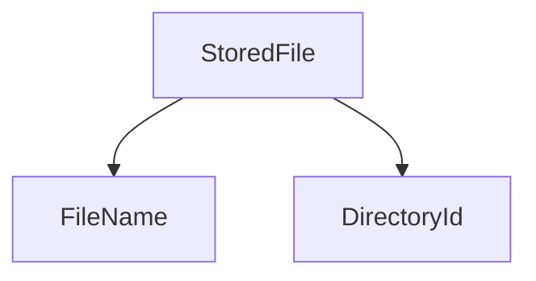
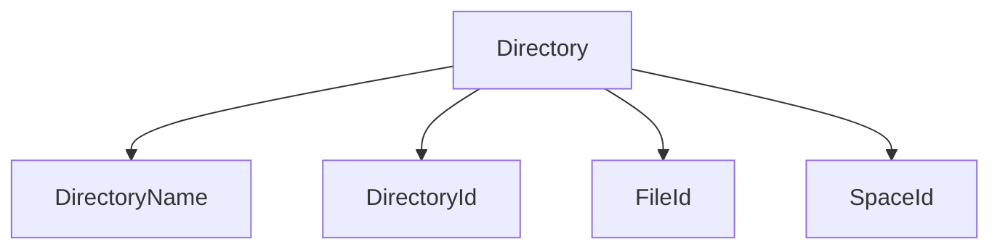
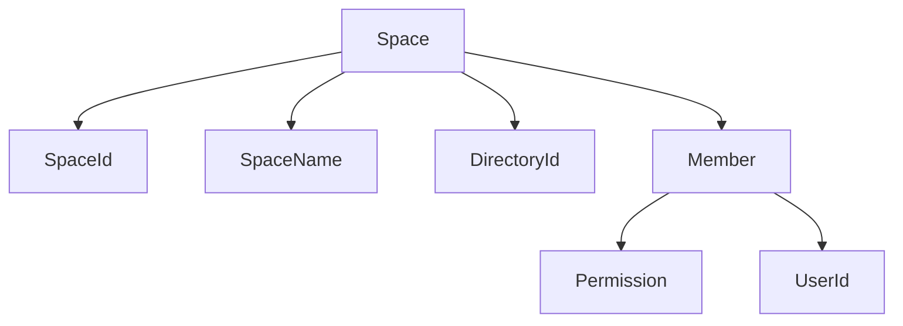
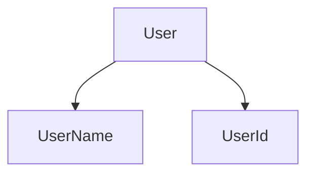

# Aggregates
> Topmost Entity is the Aggregate Root

## Core Domain: Filesystem
### StoredFile 

### Directory

  
### Space

## Sub Domain: Users
### User

# Entities and Value Objects
## Entities
- StoredFile
- Directory
- Space
- Member
- User

## Value Objects
- FileName
- FileId
- DirectoryName
- DirectoryId
- SpaceName
- SpaceId
- UserId
- UserName
- Permission